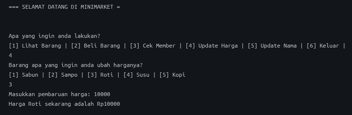
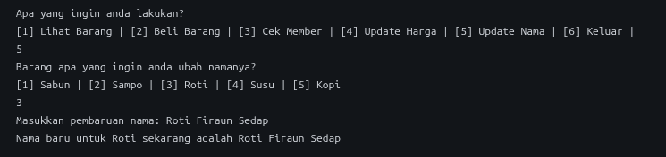
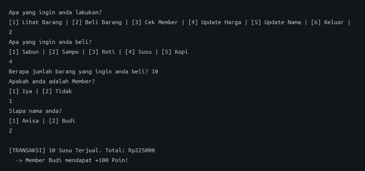
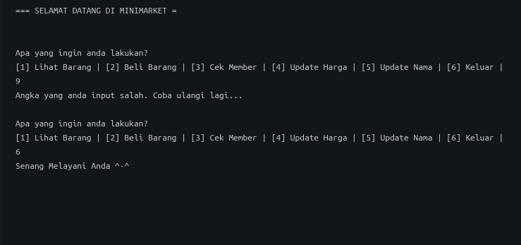

# ASISTENSI-P4-5022261061
Nama: Muhammad Ahwazi


1. Untuk tugas satu, dibuat fungsi updateHarga yang menerima pointer ke Barang dan harga baru. Karena yang dikirim adalah alamat barangnya, harga di data aslinya ikut berubah lewat operator panah.

```c
void updateHarga(Barang *b, int hargaBaru, int jenis) {
	b->harga = hargaBaru;
	printf("Harga %s sekarang adalah Rp%d", dbBarang[jenis-1].nama, hargaBaru);
}
```


2. Untuk tugas dua, dibuat fungsi updateNama. Nama adalah array of char sehingga tidak bisa diganti memakai tanda =, jadi namanya disalin dengan strcpy. Nama lama disimpan dulu di variabel sementara supaya bisa ditampilkan.
```c
void updateNama(Barang *b, char namaBaru[], int jenis) {
	char sementara[50];
	strcpy(sementara, b->nama);
	strcpy(b->nama,namaBaru);
	printf("Nama baru untuk %s sekarang adalah %s", sementara, namaBaru);
}
```



3. Untuk tugas tiga, fungsi beliBarang diubah. Setelah total dihitung, dicek dulu apakah m bukan NULL, baru dicek m->poin >= 1000. Kalau iya, total dikali 90/100 dan poin member dikurangi 1000.
```c
int total = b->harga * qty;
if(m != NULL) {
	if(m->poin >= 1000) {
		total = (total*90)/100;
		m->poin -= 1000;
	}
}

```

4. Untuk tantangan tambahan, seluruh alur program dibungkus while(1) supaya berjalan terus sampai pengguna memilih menu 6 (keluar). Pilihan menu dibaca dengan scanf lalu dijalankan dengan switch-case. Kalau angka yang dimasukkan di luar 1 sampai 6, program menampilkan pesan salah lalu mengulang menu. Berikut kode lengkapnya:


```c
#include <stdio.h>
#include <string.h>

typedef struct {
	char nama[50];
	int harga;
	int stock;
} Barang;

typedef struct {
	char nama[50];
	int poin;
} Member;

Barang dbBarang[50] = { {"Sabun", 5000, 10}, {"Sampo", 15000, 5}, {"Roti", 12000, 8}, {"Susu", 25000, 15}, {"Kopi", 22000, 20} };
Member dbMember[20] = { {"Anisa", 500}, {"Budi", 1000} };

void cekBarang(Barang db[], int ukuran);
void cekMember(Member db[], int ukuran);
void beliBarang(Barang *b, Member *m, int qty);
void updateHarga(Barang *b, int hargaBaru, int jenis);
void updateNama(Barang *b, char namaBaru[], int jenis);

int main() {

	printf("=== SELAMAT DATANG DI MINIMARKET =\n");
	while(1) {
		int g, jenis, jumlah, status, name1, hargaBaru;
		char name2[50];
		printf("\n\nApa yang ingin anda lakukan?\n");
		printf("[1] Lihat Barang | [2] Beli Barang | [3] Cek Member | [4] Update Harga | [5] Update Nama | [6] Keluar |\n");
		scanf("%d", &g);
		if (g<1 || g>6) {
			printf("Angka yang anda input salah. Coba ulangi lagi...");
			continue;
		} else if (g == 6) {
			printf("Senang Melayani Anda ^-^");
			break;
		}
		switch(g) {

		case 1:
			cekBarang(dbBarang, 5);
			break;

		case 2:
			printf("Apa yang ingin anda beli?\n");
			printf("[1] %s | [2] %s | [3] %s | [4] %s | [5] %s\n", dbBarang[0].nama, dbBarang[1].nama, dbBarang[2].nama, dbBarang[3].nama, dbBarang[4].nama);
			scanf("%d", &jenis);
			printf("Berapa jumlah barang yang ingin anda beli? ");
			scanf("%d", &jumlah);
			printf("Apakah anda adalah Member?\n[1] Iya | [2] Tidak\n");
			scanf("%d", &status);
			if (status == 1) {
				printf("Siapa nama anda?\n[1] Anisa | [2] Budi \n");
				scanf("%d", &name1);
				beliBarang(&dbBarang[jenis-1], &dbMember[name1-1], jumlah);
			} else if (status == 2) {
				beliBarang(&dbBarang[jenis-1], NULL, jumlah);
			}
			break;

		case 3:
			cekMember(dbMember, 2);
			break;

		case 4:
			printf("Barang apa yang ingin anda ubah harganya?\n");
			printf("[1] %s | [2] %s | [3] %s | [4] %s | [5] %s\n", dbBarang[0].nama, dbBarang[1].nama, dbBarang[2].nama, dbBarang[3].nama, dbBarang[4].nama);
			scanf("%d", &jenis);
			printf("Masukkan pembaruan harga: ");
			scanf("%d", &hargaBaru);
			updateHarga(&dbBarang[jenis-1],hargaBaru, jenis);
			break;

		case 5:
			printf("Barang apa yang ingin anda ubah namanya?\n");
			printf("[1] %s | [2] %s | [3] %s | [4] %s | [5] %s\n", dbBarang[0].nama, dbBarang[1].nama, dbBarang[2].nama, dbBarang[3].nama, dbBarang[4].nama);
			scanf("%d", &jenis);
			printf("Masukkan pembaruan nama: ");
			scanf(" %[^\n]", name2);
			updateNama(&dbBarang[jenis-1], name2, jenis);
			break;
		}
	}
	return 0;
}

void cekBarang(Barang db[], int ukuran) {
	printf("\n--- Katalog Barang ---\n");
	for(int i=0; i<ukuran; i++) {
		printf("%d. %s - Rp%d (Stok: %d)\n", i+1, db[i].nama, db[i].harga, db[i].stock);
	}
}

void cekMember(Member db[], int ukuran) {
	printf("\n--- Data Member ---\n");
	for(int i=0; i<ukuran; i++) {
		printf("%d. %s - Poin: %d\n", i+1, db[i].nama, db[i].poin);
	}
}

void beliBarang(Barang *b, Member *m, int qty) {
	if (b->stock >= qty) {
		b->stock -= qty;
		int total = b->harga * qty;
		if(m != NULL) {
		    if(m->poin >= 1000) {
				total = (total*90)/100;
				m->poin -= 1000;
			}
		}
		printf("\n[TRANSAKSI] %d %s Terjual. Total: Rp%d\n", qty, b->nama, total);

		if (total >= 20000 && m != NULL) {
			m->poin += 100;
			printf("  -> Member %s mendapat +100 Poin!\n", m->nama);
		}
	} else {
		printf("\n[GAGAL] Stok %s (Tersisa: %d) tidak cukup untuk dibeli sebanyak %d!\n", b->nama, b->stock, qty);
	}
}

void updateHarga(Barang *b, int hargaBaru, int jenis) {
	b->harga = hargaBaru;
	printf("Harga %s sekarang adalah Rp%d", dbBarang[jenis-1].nama, hargaBaru);
}

void updateNama(Barang *b, char namaBaru[], int jenis) {
	char sementara[50];
	strcpy(sementara, b->nama);
	strcpy(b->nama,namaBaru);
	printf("Nama baru untuk %s sekarang adalah %s", sementara, namaBaru);
}

